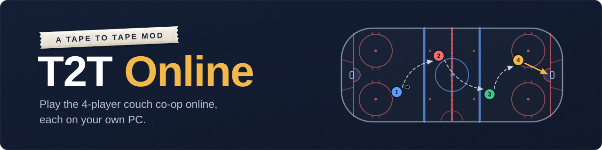
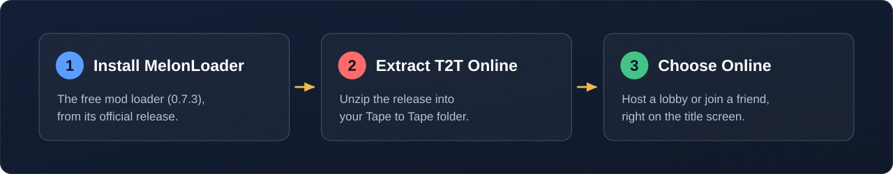
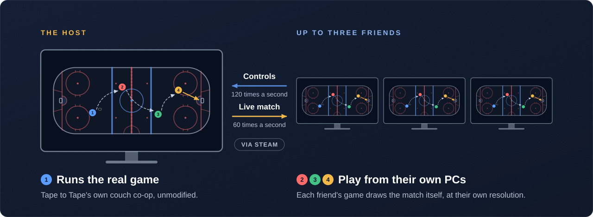

# T2T Online: Tape to Tape Online Multiplayer

**Play Tape to Tape online with your friends.** 
The game's 4-player couch co-op over Steam, in Quick Game and the full campaign, each on your own PC.

> [!IMPORTANT]
> **T2T Online is a beta in active development.** It is playable, but it is not finished: expect bugs, and expect
> screens and features to change between releases. Your saves are backed up before every online game. Please read the
> [known limitations](#known-limitations) before you plan a game night, and
> [report what goes wrong](#reporting-a-problem): every report helps.

## Contents

- **Start here:** [What is T2T Online?](#what-is-t2t-online) · [Features](#features) · [Is it safe?](#is-it-safe) ·
  [Quick start](#quick-start) · [Install](#install) · [Play your first game](#play-your-first-game) ·
  [Known limitations](#known-limitations)
- **Player guide:** [Playing together](#playing-together) · [Settings](#settings) · [Save backups](#save-backups) ·
  [Updating and uninstalling](#updating-and-uninstalling)
- **Help:** [Troubleshooting](#troubleshooting) · [Reporting a problem](#reporting-a-problem) · [FAQ](#faq) ·
  [Privacy](#privacy)
- **The project:** [How it works](#how-it-works) · [Roadmap](#roadmap) · [Contributing](#contributing) ·
  [Credits](#credits) · [License](#license)

## What is T2T Online?

**T2T Online** (Tape to Tape Online) is a free, open-source mod that adds online multiplayer to
[Tape to Tape](https://store.steampowered.com/app/1566200/Tape_to_Tape/), the hockey roguelite by Excellent Rectangle.
Tape to Tape has no built-in online play, so T2T Online takes its 4-player couch co-op online: one player hosts, and
up to three friends join over Steam from their own PCs. It is made for groups of friends who own the game and want to
play its co-op modes together without sharing a couch.

| | T2T Online at a glance |
|---|---|
| **Players** | Up to four: one host and three friends |
| **Modes** | Quick Game and the full roguelite campaign |
| **You need** | Windows, Tape to Tape on Steam (a copy for every player) and MelonLoader 0.7.3 |
| **Controls** | Gamepad, or keyboard and mouse |
| **Price** | Free and open source ([MIT License](LICENSE)) |
| **Status** | Beta, in active development |

Everything you do with the mod happens on the game's own screens. An **Online** row on the title screen opens the
**Online** menu, where you host or join a lobby. The mod's settings are an **Online** tab in the game's own
**Settings** menu (written **Settings > Online** in this guide), next to a **Save Backups** screen and a **Problem
Report** button. There is no extra window to manage, and the mod adds only one key, which is optional:
<kbd>Insert</kbd> marks a moment for a problem report.

T2T Online is an unofficial, fan-made mod. It is not made or endorsed by Excellent Rectangle.

## Features

- **Quick Game and the campaign, online.** Play Quick Game matches and the complete roguelite campaign together. In a
  run, every player sees the same map, rewards and event choices.
- **The real game on every screen.** Each player's own game draws the match, with its own sound, camera, HUD and
  menus, at that player's resolution. Nothing is streamed as video.
- **Native menus in 15 languages.** The lobby and the settings are built from the game's own menus and follow the
  language you set in the game.
- **Progress for everyone.** Stats, unlocks, bench quests and achievements earned together count on each player's own
  profile.
- **Your own controls.** Each player uses a gamepad or keyboard and mouse, with their own button mapping.
- **Dropped connections are handled.** If a friend's connection drops, the AI plays their skater until they are back,
  and the host keeps their seat.
- **Automatic save backups.** Your saves are backed up before every online game and can be restored from the game's
  own Settings.
- **Steam does the connecting.** Lobbies, invites and **Join Game** all work through Steam and its relays. There is no
  port forwarding and no server to run, and the players you connect to never learn your IP address.

### How it compares with Remote Play Together and Parsec

Streaming tools send a video of the host's screen to everyone else. T2T Online runs the game on every player's PC
instead.

| | T2T Online | Remote Play Together, Parsec |
|---|---|---|
| **What friends see** | The game, drawn by their own PC at their own resolution | A video stream of the host's screen |
| **Picture and sound** | Native, with no video compression | Compressed, and limited by the connection |
| **Joining** | The game's own Online menu, lobby and Steam invites | A Steam overlay invite, or the Parsec app |
| **Progress and achievements** | Count on every player's own profile | Saved by the host's copy of the game |
| **Who needs the game** | Every player | Only the host |

As with streaming, in this version each friend's controls go to the host's game, so friends play with a small network
delay. Running your own skater on your own PC is the next big step on the [roadmap](#roadmap).

## Is it safe?

T2T Online is built to be careful with your game, your saves and your privacy.

- **Your saves are backed up** before every online game (if a backup cannot be made, the game says so before you
  play), and you restore them from the game's own Settings ([Save backups](#save-backups)). While you play in a
  friend's game, your own campaign run is never written.
- **It adds files; it never changes the game's.** The mod is one folder, `Mods\T2TOnline`, and one text file. Delete
  them and it is gone ([Uninstalling](#uninstalling)).
- **It uploads nothing.** There is no telemetry, no account and no update check: the mod talks to Steam and to
  nothing else ([Privacy](#privacy)).
- **Your IP address stays private.** Every connection goes through Steam's relays, and only the host's Steam friends
  can join.
- **Logs and problem reports are written to name nobody:** no Steam names or IDs, folder paths, IP addresses or local
  times ([Reporting a problem](#reporting-a-problem)).
- **It is open source** under the MIT License, and every release lists the SHA-256 digest of its zip
  ([Check your download](#check-your-download)).

Two things to know before you start. MelonLoader's and the mod's files are not code-signed, so Windows can block them
until you allow them ([Troubleshooting](#troubleshooting)). And in an online game the host's game decides what your
game shows, as it would on a couch, so play with people you trust ([Privacy](#privacy) explains what your game checks).

## Quick start

Setup takes a few minutes, and each player does it once. The full steps are just below: [Install](#install), then
[Play your first game](#play-your-first-game).

## Install

This guide is for the [latest release](https://github.com/Zhaeroth/tape-to-tape-online/releases/latest). The zip also
holds `T2T Online - READ ME FIRST.txt`, a plain-text copy of the install, play and uninstall steps.

### Requirements

| You need | Notes |
|---|---|
| **Windows 10 or 11** (64-bit) | Linux and Steam Deck are not supported yet ([FAQ](#faq)) |
| **Tape to Tape on Steam**, fully updated | Every player needs their own copy, on the same game version |
| **[MelonLoader](https://github.com/LavaGang/MelonLoader) 0.7.3** | A free, widely used tool that lets a game load mods. Other versions are not supported, and neither is another mod loader (BepInEx, for example) in the same game folder |
| **Steam running, and a Steam friendship with the host** | Only the host's Steam friends can join |
| **The same T2T Online release as the host** | A different release joins only if it uses the same protocol (the network format; the [changelog](CHANGELOG.md) names each release's), and the game then shows a notice that everyone should have the same release. A release with another protocol cannot join |
| **A gamepad, or keyboard and mouse** | |
| **About 300 MB of free disk space** | MelonLoader uses it for the files it prepares on the first launch |

A voice call (Discord or any other) is not part of the mod, but it makes a game night much easier.

### Steps

1. **Open the game folder.** Close Tape to Tape, then in Steam right-click **Tape to Tape** > **Manage** >
   **Browse local files**. A folder opens with `Tape to Tape.exe` in it. Leave it open.
2. **Install MelonLoader 0.7.3.** Download `MelonLoader.x64.zip` from the
   [MelonLoader 0.7.3 release](https://github.com/LavaGang/MelonLoader/releases/tag/v0.7.3) and extract it into the game
   folder: in Windows, right-click the zip > **Extract All** > **Browse**, and pick the game folder itself (not a
   folder inside it, and not the new folder named after the zip that Windows suggests). With 7-Zip or WinRAR, copy the
   zip into the game folder and choose **Extract Here**. Skip this step if MelonLoader 0.7.3 is already installed.
3. **Install T2T Online.** Download `T2TOnline-<version>.zip` from the
   [latest release](https://github.com/Zhaeroth/tape-to-tape-online/releases/latest) and extract it into the game
   folder the same way, replacing files if asked. Two things are added: the `Mods\T2TOnline` folder (the whole mod)
   and `T2T Online - READ ME FIRST.txt`. `version.dll`, `MelonLoader` and `Mods` should now sit next to
   `Tape to Tape.exe`; if they landed in a new subfolder, move them up.
4. **Launch the game from Steam.** A MelonLoader console window opens alongside the game. Leave it open: closing it
   closes the game. When the game reaches its title screen, a new **Online** row sits under **Play Now**. That row is
   how you know the mod works.

> [!NOTE]
> **The first launch takes a few extra minutes** while MelonLoader prepares the game, and it needs an internet
> connection. The game window may stay black or show "Not Responding" during this time; the console window shows the
> progress. Later launches start normally. MelonLoader prints many lines, some in yellow, and says "0 UserLibs loaded"
> although T2T Online's libraries loaded: that is normal. If MelonLoader says the .NET 6 runtime is missing, allow
> Windows to install "Microsoft .NET Runtime" when it asks.

If something does not work, see [Troubleshooting](#troubleshooting).

### Check your download

Every release lists the SHA-256 digest of its zip, and a `.sha256` file sits beside the zip. In PowerShell,
`Get-FileHash .\T2TOnline-<version>.zip -Algorithm SHA256` prints the digest of the file you have; it must equal the
one published. If it does not, download the zip again. MelonLoader 0.7.3's `MelonLoader.x64.zip` has the digest
`5b2b2f3d1cd42b59ec886c5bdc2663edae87a0097a4f4a8f58c0965a99dda416`.

## Play your first game

1. **Everyone** installs the same release and joins a voice call.
2. **The host** goes to the title screen, chooses **Online** > **Host Lobby**, invites friends (<kbd>A</kbd> on an
   empty seat), picks **Campaign** or **Quick Game** (<kbd>LB</kbd> and <kbd>RB</kbd>) and presses **Start**.
3. **Each friend** goes to the title screen, chooses **Online** > **Join Lobby**, picks the host and presses
   <kbd>A</kbd>. Accepting the host's Steam invite works too.
4. **Play.** When a game ends, everyone is back in the lobby, and the host can start another.

[Playing together](#playing-together) covers the details: the lobby's controls, how a campaign and a Quick Game start,
your own settings during a game, leaving, and what happens when a player drops.

## Known limitations

T2T Online is a beta. These are the things to know before you rely on it.

- **Lightly tested between PCs.** Online play has been played between two PCs with two players on gamepads, on an
  earlier release. Three and four players, a host or a friend on keyboard and mouse, and a campaign played through to
  a win have not been played between PCs yet. Later changes, including the screens this release adds (**Settings >
  Online**, **Save Backups**, **My Settings**) and the way a campaign seats every player, have been checked on one PC
  only, by the mod's automated checks with a stand-in friend, which cannot show everything a real friend's game does.
  Expect to find problems, and please [report them](#reporting-a-problem).
- **Input delay for friends.** A friend's controls travel to the host's game and the picture travels back before their
  skater moves, so friends feel about the connection's round trip to the host plus a frame or two. The host plays
  without delay. Local skating is the next stage on the [roadmap](#roadmap).
- **Game updates switch online off** until a T2T Online release made for that game version is out. The game plays
  normally meanwhile. See [Get notified of releases](#get-notified-of-releases).
- **Modes.** Quick Game and the campaign are online. The tutorial, Shootout, Tournament and Practice are not.
- **Friends only, up to four.** Only the host's Steam friends join, on the same game version and the same T2T Online
  protocol. There is no public matchmaking, host migration (if the host leaves, the game ends) or text chat.
- **The host's run.** A co-op campaign is the host's run, saved on the host's PC. A friend's own run is never touched,
  and a friend cannot continue the host's run without the host.
- **A friend who is rejoining mid-game cannot leave from a menu.** After a drop in a game, a friend's game tries to
  rejoin for up to 2 minutes, and **Leave Online Game** is not reachable during that time unless your own Settings was
  already open. (In the lobby, <kbd>B</kbd> leaves as usual.) Closing the game is always safe.
- **A friend can drive a menu the host has opened.** A friend cannot open the host's menus. But while the host's pause
  menu or the campaign map's menu is up, a friend's presses reach it and the menus opened from it (the lineup, the
  host's own Settings, **Concede**), as the game's couch rules let any player use them. It takes a deliberate series of
  presses to change anything, but play with people you trust.
- **Texts that stay in English or one form.** The mod's words are in all 15 of the game's languages, but they were
  written without native-speaker review, so some may read oddly: please tell us which. Notices in the corner of the
  screen are English. A few messages (the reason a setting could not be saved or a restore did not finish) and the
  dates on the Backups screen (`2026-11-05 19:30`) use one form in every language, and a rare toast or prompt that
  comes from the host's game can show in the host's language.
- **Windows only.** Linux and Steam Deck are untested and not supported yet (see the [FAQ](#faq)).
- **One mod loader.** T2T Online runs on MelonLoader 0.7.3. It is not tested with other mod loaders or with other mods,
  and BepInEx mods (a display or camera fix, for example) are not supported alongside it in the same game folder.

## Playing together

A game has one **host** and up to three **friends**. The host runs the game, and each friend's game shows the same
match on their own PC. Until the host starts a game, your own game, gamepad and saves stay your own, and after each
game everyone returns to the lobby.

Everything starts at the title screen: press Down to **Online** (under **Play Now**) and press <kbd>A</kbd>, or click
it. The **Online** menu has five rows: **Host Lobby**, **Join Lobby**, **Online Settings**, **Report a Problem** and
**Back**. Under **Join Lobby** the game says who is hosting, for example "Alex is hosting".

### Hosting a game

1. Choose **Online** > **Host Lobby**. The lobby opens with you in the first of four seats.
2. **Invite friends:** choose an empty seat or **Invite Friends** and pick a friend from the list (**Invite**), or use
   the **Steam overlay** from the same list. Friends can also join from **Join Lobby** or from Steam. Only your Steam
   friends can join.
3. Choose the mode with the **Game Mode** selector (<kbd>LB</kbd> and <kbd>RB</kbd> on a gamepad): **Campaign** or
   **Quick Game**. For a campaign, also choose the **Co-op Save** slot (1 to 3): the host's co-op runs are kept apart
   from your own run.
4. Press **Start**. A countdown of 3, 2, 1 shows on every screen, and you can cancel it with <kbd>B</kbd>. If a friend
   is still loading, a question asks whether to wait or start anyway.

### Joining a game

Choose **Online** > **Join Lobby**, pick the host in the list and press <kbd>A</kbd>. The list shows your Steam friends
who are hosting. A greyed row says why it cannot be joined when you press <kbd>A</kbd> on it (**Why?**): another T2T
Online version, another game update, or a full lobby. **Refresh** (<kbd>X</kbd>) looks again.

You can also accept the host's Steam invite, or use **Join Game** on the host's name in your Steam friends list. If the
game is closed, Steam starts it and you join as soon as the title screen is up.

A few things to know before you join:

- **Join from the title screen.** If you are in your own run, a notice asks you to go back to the title screen first
  (your run is saved).
- **Answer the tutorial question first.** If your game asks whether you want the tutorial (a new profile is asked
  once), answer it before you join: once the host starts a game, your game cannot answer it and closes the question
  for you (as "No").
- **Press again if nothing happens.** If Steam started the game for an invite and your first button press does
  nothing, press again: the first press can just wake the gamepad.
- **Restart Steam if friends cannot be checked.** If a message says Steam could not check your friends list, restart
  Steam and the game. The mod only connects to players Steam confirms as friends.

### In the lobby

The lobby shows four seats with each player's name, a ping indicator and a **Ready** mark. A friend's pad answers their
own lobby screen, not the host's game.

| | Host | Friend |
|---|---|---|
| **Seat actions** | <kbd>A</kbd> on an empty seat invites; <kbd>X</kbd> on a card opens that player's Steam profile (when Steam's overlay is available); <kbd>LT</kbd> removes a friend (after a question) | <kbd>A</kbd> on your own card marks you **Ready** or not; <kbd>X</kbd> opens a Steam profile (when Steam's overlay is available) |
| **Mode and save** | <kbd>LB</kbd> and <kbd>RB</kbd> change **Game Mode**; the **Co-op Save** row picks the slot; <kbd>X</kbd> on a used slot starts a new run there (the game asks first) | The host chooses |
| **Start** | **Start** (the button, or the Start button of your pad) | The host presses it |
| **Settings** | <kbd>RT</kbd> opens your own Settings | <kbd>RT</kbd> opens your own Settings |
| **Leave** | <kbd>B</kbd> closes the lobby and takes you back to the Online menu (it asks first when a friend is in the lobby) | <kbd>B</kbd> leaves the lobby (after a question) and takes you back to the Join Lobby list |

The **Ready** mark is for information: the host does not need everyone to be ready, and the marks clear when a game
ends. Your own **Settings** screen is the game's: change your language, volume or controls, and open **Settings >
Online** (see [Settings](#settings)). Your own game, controller and saves are still yours in the lobby.

### Starting a campaign or a Quick Game

**Campaign.** The host chooses **Campaign**, a **Co-op Save** slot and presses **Start** (the button reads **New Run** on
an empty slot and **Continue Run** on a used one). The game's own screens follow for everyone: the squad screen, the map,
match previews, rewards and event choices. The host makes the choices that only one player makes on a couch, and
everyone sees them live, with the selection highlighted, so talk them over on your voice call.

**Everyone in the lobby plays.** When a campaign starts, the host and every friend in the lobby are on the team, so
nobody needs to open the game's **Controllers** screen. A friend who joins during a run watches the rest of the current
match and plays from the next one. The game's own **Controllers** screen (the map's menu) still works as on a couch: a
player who wants to sit out can move to the middle, and that choice is kept for as long as the host keeps hosting. If
the host picks the game's solo squad (a squad made for one player), only one player plays, as on a couch. The run is
the host's: it is saved on the host's PC, in the chosen co-op slot.

**Quick Game.** The host chooses **Quick Game** and presses **Start**. The game's own controller screen opens on every
PC: each player moves their icon to a side with their own controls and readies up, and the host starts the match. When
a match ends, everyone goes back to the lobby by themselves.

### During a match

- **Play as you would on a couch.** Your own controls play your own skater, and the marker over it has your colour.
  Your pad vibrates for your skater if your game's controller rumble setting is on (keyboards have no rumble).
- **Gamepad.** It works as it does in the game, with your own button mapping.
- **Keyboard and mouse.** You use your own key bindings from the game's controls. Choose **Keyboard** in **Settings >
  Online > Play Online With**, or leave it on **Auto** (a gamepad if one is connected, else the keyboard and mouse).
  Your keys play on the host's game and your mouse stays on your PC. In the lobby and in your own Settings the keyboard
  and mouse work as in the game's own menus.
- **My Settings and Leave Online Game, mid-run.** A friend's pad or keyboard cannot open the host's menus, so a friend
  has their own way in. While the host's pause menu is up, a **My Settings** prompt sits at the bottom of the screen
  (press <kbd>RT</kbd> on a pad, <kbd>Left Alt</kbd> on a keyboard, or click it). On the campaign map, the map's own
  **Menu** entry opens your Settings (<kbd>Start</kbd> on a pad, <kbd>Esc</kbd> on a keyboard, or a click). Either way
  the game's **Settings** opens on the **Online** tab: change what you like, or choose **Leave Online Game** to go
  back to your own title screen. While your Settings is open in a match, the host's AI plays your skater (after 3
  seconds).
- **Leaving.** A friend leaves with **Leave Online Game**; in a match their seat is kept for 2 minutes. The host ends
  the game for everyone with **End Online Game** (their own Settings > Online, from the pause menu or the lobby); the
  friends' games go back to their own game and a prompt says the host closed the lobby. Quitting the game is always
  safe.
- **Your progress.** What the run credits counts on your own profile too, from your own numbers: if an unlock needs 15
  goals and you are at 14, the next goal unlocks it for you whatever the host's count. Achievements earned together
  (a mercy win, every skater scoring, winning the run) unlock for you for the matches your own game played. The
  [Privacy](#privacy) section says exactly what your game checks.

### If a player drops

- **A friend's connection drops.** After 3 seconds without them, the AI plays their skater, and the lobby shows
  **Reconnecting** on their card. The host keeps their seat: 30 seconds in the lobby and 2 minutes in a game. Their game
  tries to rejoin by itself, and when it does, their skater is theirs again. A host who prefers can turn the AI
  stand-in off with `AiStandIn = false` in `settings.cfg`.
- **A friend's game cannot load the host's next match.** The AI plays their skater at once, and a prompt in their game
  offers **Try again** (leave and join the same lobby again) or **Leave**.
- **The host's connection drops.** A friend's game shows **Reconnecting** and tries to rejoin; if it cannot, a prompt
  says the connection was lost and that their own progress is safe.
- **Closing the game** at any time is safe. A restart brings you back to your own title screen with your own saves.

## Settings

The mod's settings are on the **Online** tab of the game's own **Settings** menu. Open it from any of these:

- the title screen's **Settings** row (the **Online** tab is the eighth, after **Stats**);
- the title's **Online** menu, **Online Settings** (opens **Settings** on the **Online** tab);
- the lobby, with <kbd>RT</kbd>;
- the pause menu's **Settings**, in a match;
- a friend's own **My Settings** (see [During a match](#during-a-match)).

It works with online on, with online off (a start-up check failed, say) and after online stopped on an error. On a
game version the mod does not support yet, the **Online** tab is not installed (see [FAQ](#faq)). Each row has a tooltip,
as the game's own rows do.

| Row | What it does |
|---|---|
| **Share Achievements** | Achievements earned together unlock on every player's own Steam account. Off: you neither send nor receive them. On by default. |
| **Share Progress** | A co-op run counts on every player's own profile. Off: you send none, and what a host sends you waits; it is applied if you turn the setting back on during that same online game. On by default. |
| **Play Online With** | **Auto**, **Controller** or **Keyboard**: what you play with in a friend's game. **Auto** takes a gamepad if one is connected, else the keyboard and mouse. Applies when you join and when the host starts a game. |
| **Direct Connections** | Shown only when it is on, or after Steam refused to keep your connections relayed on this PC. Lets Steam connect you straight to other players, which shares your IP address with them. Turning it on asks first (the question opens with **Cancel** selected) and takes effect from the next start of the game. It can be turned on only while nobody else is in your online game (otherwise the game says **Leave the online game first.**), so turn it on at the title screen; it can be turned off at any time. Off by default: see [Privacy](#privacy). |
| **Save Backups** [**View**] | Opens the **Backups** screen: see [Save backups](#save-backups). Only from the title screen and out of an online game: in a match the row says it can only be opened from the main menu, and in an online game (the lobby included) a prompt says "Leave the online game first." |
| **Problem Report** [**Make Report**] | Makes the problem report zip: see [Reporting a problem](#reporting-a-problem). |
| **Leave Online Game** or **End Online Game** [**Leave**, **End**] | Shown only in an online game: a friend leaves, the host ends the game for everyone. Both ask first. |

<b>The settings file, for those who want it</b>

 

These choices are saved in `UserData\T2TOnline\settings.cfg`, which you can also edit with the game closed. Its entries
are named differently from the rows: `ShareAchievements`, `ShareProgress`, `OnlineInput` (**Play Online With**: `Auto`,
`Gamepad` or `KeyboardMouse`) and `AllowDirectConnections` (**Direct Connections**). The file also holds `CoopSlot`
(the lobby's **Co-op Save** choice), `NativeLobby` (a developer entry: for players it always reads as on) and three
host options that have no row, all on by default: `AiStandIn` (the AI plays a dropped friend's skater),
`FightGraceWindow` (a short allowance for a friend's network delay in a fight) and `NurseRealScreen` (friends see the
Nurse's own screen). A change on screen applies at once, except Direct Connections, which is read when the game starts.

## Save backups

Before every online game (before you host, before you follow a host, and when a game starts) the mod copies your game
saves and your co-op runs to `%LOCALAPPDATA%\T2T Online\backups\`. It keeps the newest 10 backups, the first backup of each
of the last 7 days on which one was taken, and the first one ever taken. A backup identical to the newest one is not made twice.
While a restore is unfinished, the backup being restored and the one taken just before it are kept too.

To restore one, go to the title screen, open **Settings > Online** and choose **Save Backups** > **View**. The **Backups**
screen has two tabs (<kbd>LB</kbd> and <kbd>RB</kbd> switch between them):

- **Your Saves:** one row per backup that holds your game's saves, with the time it was taken (your local time, as
  `2026-11-05 19:30`), why it was taken (**Before hosting**, **Before following a host**, **Before starting a game**,
  **Before a restore**) and how many files it holds.
- **Co-op Runs:** one row per backup and co-op slot.

Select a row to see what restoring it does, then press <kbd>A</kbd> (or click **Restore**) and answer the game's
question. What is on your PC now is backed up first, so a restore can always be undone with another restore. Restoring
a co-op run is immediate. Restoring **Your Saves** needs the game to restart: when it is done, a prompt offers
**Later** or **Quit**, and until you restart, nothing is saved. If Steam Cloud has newer saves than the ones you
restored, the game uses those, and a notice says so. If a notice says Steam Cloud may have undone your restore,
restore again from **Save Backups** once online is back. <kbd>B</kbd> goes back.

## Updating and uninstalling

### Updating

Close the game and extract the new release into the game folder the same way, replacing files. Your settings, logs,
save backups and saves are kept. Update together with the people you play with, so everyone has the same release.

If a release needs a newer MelonLoader, MelonLoader's own rule applies: delete `version.dll` and the `MelonLoader`
folder first, then install the new one.

If the install holds files of two releases (an older `T2TOnline.Core.dll` beside a newer plugin, for example), T2T Online
switches itself off, says so in the corner of the title screen and names the files to delete. Delete them, then extract
the zip again.

<b>Updating from 0.10.0 Beta or earlier</b>

 

Those releases put their files in the game folder's `Plugins` and `UserLibs` folders (and `LICENSE` and
`THIRD_PARTY_NOTICES.md` next to the game). From 0.11.0 on, the mod is in `Mods\T2TOnline`. On the first start T2T
Online finds the old files, keeps online off, and shows a prompt in the game that names every file to delete (six in
`Plugins` and `UserLibs`, and the two documents when they are there). T2T Online does not delete them for you: close the
game, delete the named files and start again.

Your settings move on their own from `UserData\MelonPreferences.cfg` to `UserData\T2TOnline\settings.cfg`, and the
session logs of 0.10.0 and earlier are deleted once, because they hold Steam names. 0.10.x and earlier cannot play with
0.11.0 and later.

### Get notified of releases

Tape to Tape updates from time to time, and each game update switches online play off until a T2T Online release made
for it is out (the game itself plays normally meanwhile). To hear about releases, open this repository on GitHub, choose
**Watch** > **Custom** and tick **Releases**. The
[Releases page](https://github.com/Zhaeroth/tape-to-tape-online/releases) lists every release with its notes and the
digest of its zip. T2T Online does not check for updates itself: it never contacts GitHub.

### Uninstalling

Close the game first. If you hosted a co-op campaign and the game closed in the middle of a match, start the game once
with the mod and quit at the title screen before you uninstall: that puts your own run's counters back. If you restored
saves from **Save Backups**, start the game once more before you uninstall.

1. **The mod only** (MelonLoader and other mods stay): delete the `Mods\T2TOnline` folder and
   `T2T Online - READ ME FIRST.txt` from the game folder. Files named `T2TOnline*` in `Plugins` or `UserLibs`, and
   `LICENSE` or `THIRD_PARTY_NOTICES.md` next to the game, come from 0.10.0 or earlier: delete those too.
2. **MelonLoader as well** (only if you have no other mods): also delete `version.dll` and the `MelonLoader`, `Mods`,
   `Plugins`, `UserLibs` and `UserData` folders from the game folder. If MelonLoader installed .NET 6 for you, it stays in
   Windows' Apps list; remove it only if nothing else needs it.

You can remove the mod at any time, even right after a crash.

### Where your data lives

| Where | What | If you delete it |
|---|---|---|
| `UserData\T2TOnline\` in the game folder | The mod's settings (`settings.cfg`), logs and problem reports | The settings go back to their defaults |
| `%LOCALAPPDATA%\T2T Online\` (paste it into Explorer's address bar) | Your save backups, a host's co-op runs, the record of the progress shared with you, the host logos your run history shows | The backups are gone, and so are a host's co-op runs: they exist only there |
| A `.bac` file in the game's save folder | The game's own copy of a save | Leave it |

Each of the two folders has a `README.txt` saying what it holds. Your own saves keep the progress you earned together;
that is intended. Steam's **Verify integrity of game files** does not remove the mod; deleting the files above does.

## Troubleshooting

<b>There is no Online row on the title screen</b>

 

Check that MelonLoader 0.7.3 is installed: the console window shows its version when the game starts. If online play is
off, a notice in the top-left corner of the title screen explains why. It stays up for about half a minute once the title
is up. Common reasons:

- **The game was updated.** The notice says the game was updated after this T2T Online was made (or that Steam has an
  update waiting, or that your game is older than this release). The mod stays off until a T2T Online made for the new
  game version is installed; the notice names the releases page.
- **Old files from 0.10.0 or earlier.** The game's prompt says "Online is off until old T2T Online files are deleted" and
  lists them: close the game, delete them and start again (see [Updating](#updating)).
- **Part of T2T Online is from another version.** The notice says so and names the files to delete: close the game,
  delete them and extract the zip again.

If there is no Online row and no notice, the mod did not load:

- **The files are not where MelonLoader looks.** `Mods\T2TOnline` must sit in the game folder, next to
  `Tape to Tape.exe` ([Steps](#steps), step 3).
- **MelonLoader's `UserData\Loader.cfg` has `disable_subfolder_load = true`.** MelonLoader then does not load
  `Mods\T2TOnline`: set it to `false`.
- **MelonLoader could not prepare the game.** See "The game won't start" below.

<b>Windows blocks a file, or says part of the app has been blocked</b>

 

MelonLoader's and T2T Online's files are not code-signed. Windows 11's Smart App Control and Defender can block or remove
such files: allow them in Windows Security (for `version.dll`, MelonLoader's loader), or turn Smart App Control off
under **App & browser control**.

<b>The game won't start, or has no Online row, after a Tape to Tape update</b>

 

The first launch after an update takes a few minutes and needs an internet connection, so give it time. If the console
says "Failed to start MelonLoader", the game shows "INTERNAL FAILURE", or there is no Online row and no notice in the
corner: close the game, delete the `MelonLoader` folder in the game folder, install MelonLoader 0.7.3 again, extract
T2T Online again, and launch with an internet connection.

<b>MelonLoader asks for .NET 6, or an antivirus blocks a file</b>

 

If MelonLoader does not install it by itself, install the
[.NET 6.0 Runtime](https://dotnet.microsoft.com/download/dotnet/6.0) for Windows x64 and launch again. If an antivirus
removes `version.dll` or `MelonLoader\Dependencies\Il2CppAssemblyGenerator\Cpp2IL\Cpp2IL.exe`, allow them: they belong
to MelonLoader.

<b>The host does not appear in Join Lobby</b>

 

You must be Steam friends with the host. The list shows friends who are hosting; if the host's Steam status or game
details are private, they may not show up. Ask the host for a Steam invite instead. A host on another game update or
another T2T Online version shows greyed: press <kbd>A</kbd> on the row (**Why?**) to see the reason.

<b>A prompt says online is off: Steam could not keep your connections relayed, or could not check your friends list</b>

 

The first prompt appears when Steam does not keep the relay-only setting, so T2T Online switches online off instead of
sharing your IP address. The second appears when Steam cannot tell the mod whether someone is your friend. In both cases
restart Steam and the game. On a network that blocks Steam's relays, the first prompt says to turn on **Settings >
Online > Direct Connections** and restart the game, to let Steam connect you directly; your IP address is then shared
with the players you connect to.

<b>Save Backups does not open</b>

 

**Save Backups** only opens from the title screen, out of an online game. In a match, its row says it can only be
opened from the main menu. In an online game, the lobby included, a prompt says "Leave the online game first." Leave,
go back to the title screen, then open **Settings > Online** again.

<b>A message says Online could not open, or online stopped after an error</b>

 

Restart the game. If it happens again, make a problem report in **Settings > Online** (the game also offers one at the
title screen after an online game that ended in an error). Your own saves and runs are not affected.

<b>My first button press does nothing after Steam started the game</b>

 

Press again. When Steam starts the game from an invite, the first press can just wake the gamepad.

Still stuck? [Make a problem report](#reporting-a-problem) and
[open an issue](https://github.com/Zhaeroth/tape-to-tape-online/issues/new/choose), or ask in
[Discussions](https://github.com/Zhaeroth/tape-to-tape-online/discussions). We are glad to help.

## Reporting a problem

When something goes wrong, the mod can make one zip that holds what a maintainer needs and nothing that names you.

1. **Mark the moment** (optional, but it helps). Press <kbd>Insert</kbd> when it happens. The game shows "Moment 1
   marked for a bug report." and the report will show where.
2. **Make the report.** Open **Settings > Online** and choose **Problem Report** > **Make Report**, or on the title
   screen choose **Online** > **Report a Problem**. It works while the game runs, including in a match (from the pause
   menu's **Settings**). When it is ready the game shows a prompt: "Saved as `<zip name>` in the game folder, under
   UserData/T2TOnline/reports. Post it with a few words about what happened at
   `github.com/Zhaeroth/tape-to-tape-online/issues`. It holds no Steam names or IDs." At the title screen the prompt
   offers **Show File**, which opens Explorer with the zip selected; in a match it only tells you where the zip is.
3. **Post it.** [Open a bug report](https://github.com/Zhaeroth/tape-to-tape-online/issues/new?template=bug_report.yml),
   attach the zip, and say what you saw, what you expected, the T2T Online version (it is in the zip's `report.txt` and in
   the name of the zip you installed) and which mark it was.

The zips are saved in `UserData\T2TOnline\reports\`, and the newest 5 are kept. Each player in a session makes their own
report.

After an online game that ended in an error, or after the game closed in the middle of one, the game offers a report
once, the next time the title screen is idle: "Your last online game ended with an error. Make a problem report now?"
(or "The game closed during your last online game. Make a problem report now?"), with **Not Now** and **Make Report**.

<b>What the zip holds</b>

 

The newest three session logs of the mod, MelonLoader's newest two logs and Unity's `Player.log` and `Player-prev.log`,
and `report.txt`, a plain-text list of what is in it and what was left out (the build, the settings not at their
defaults, other mods, the marks and the tags of this PC). Every line is cleaned first: no Steam names or IDs, folder
paths, IP addresses, local times (MelonLoader's are converted to UTC) or time zones, and only the maker and driver of
your graphics card. It never holds your saves, backups, co-op runs, settings file or developer output. Look inside
before you post it, and add a screenshot if the problem is on screen, but not one that shows your Steam friends list.

<b>If the game's own screens are not available</b>

 

On a game version the mod does not support yet, there is no **Online** tab: hold <kbd>Insert</kbd> for 2 seconds to
make the report instead (the corner notice at the title screen says so). If the game will not start at all,
`MelonLoader\Latest.log` in the game folder is the one log left. It is **not** cleaned: it holds your game folder's
path, which includes your Windows user name, your local times and whatever other mods print. Read it before you share
it, and do not post it publicly if it holds anything you would rather not share: say in the issue that you have it.

> [!CAUTION]
> Reports from 0.10.0 and earlier, and the logs that came with them, hold Steam names and IDs. Please don't post those.

## FAQ

<b>Can you play Tape to Tape online?</b>

 

Yes, with T2T Online. Tape to Tape itself has no built-in online multiplayer; this mod takes the game's 4-player couch
co-op online for Quick Game and the campaign, over Steam. See [Quick start](#quick-start).

<b>How do I play Tape to Tape online with friends?</b>

 

Everyone [installs](#install) MelonLoader 0.7.3 and the same T2T Online release. One player chooses **Online** > **Host
Lobby** on the title screen and invites the others, who choose **Online** > **Join Lobby** or accept the Steam invite.
[Play your first game](#play-your-first-game) has the four steps.

<b>Is T2T Online free? Is it official?</b>

 

It is free and open source under the [MIT License](LICENSE). It is an unofficial fan project: it is not made, sponsored
or endorsed by Excellent Rectangle, the game's developer.

<b>Is it finished?</b>

 

Not yet. It is a beta in active development: see [Known limitations](#known-limitations) and the [roadmap](#roadmap).

<b>How many players can play, and does every player need to own Tape to Tape?</b>

 

The host and up to three friends: four players, as in the game's couch co-op. Each player needs their own copy of the
game on Steam, updated to the same version.

<b>Which modes can be played online?</b>

 

Quick Game and the full campaign. The tutorial, Shootout, Tournament and Practice are not available online yet.

<b>Do my progress and achievements count when I join a friend's game?</b>

 

Yes. A co-op campaign is the host's run and is saved on the host's PC, but the unlocks, stats and achievements you earn
together count on your own profile, against your own numbers. You can turn this off in **Settings > Online** (**Share
Progress**, **Share Achievements**).

Your game takes progress only from the host you joined, only as far as your own play with that host explains, and
shared achievements only for matches and runs your own game saw. [Privacy](#privacy) says exactly what it checks; play
with people you trust.

<b>Is it safe for my saves?</b>

 

Before every online game, the mod backs up your save files to `%LOCALAPPDATA%\T2T Online\backups\`. You can restore
them from **Settings > Online > Save Backups** ([details](#save-backups)). While you play in a friend's game, your own
campaign run is never written. [Is it safe?](#is-it-safe) has the short list.

<b>Is there any input delay?</b>

 

In this version, a friend's controls travel to the host before their skater moves, so friends play with a small network
delay. The host plays without delay. Running your own skater on your own PC is on the [roadmap](#roadmap).

<b>What happens when Tape to Tape updates?</b>

 

The game keeps working normally, but online play is switched off until a T2T Online release for that update is out. A
notice in the top-left corner of the title screen says so, for about half a minute, and says to hold Insert for
2 seconds to make a problem report. See [Get notified of releases](#get-notified-of-releases).

<b>Do all players need the same version of T2T Online?</b>

 

Yes, everyone should install the same release. A release with the same protocol joins with a notice, and one with
another protocol cannot join: the lobby row says **Different T2T Online version**, and the prompt names both versions.
Install the host's version.

<b>Does it work on Linux, macOS or Steam Deck?</b>

 

T2T Online is made and tested for Windows. Linux and Steam Deck are untested and not supported yet. Under Proton,
MelonLoader needs the Steam launch option `WINEDLLOVERRIDES="version=n,b" %command%`. The mod's functions are all on
the game's own screens, so a gamepad is enough; marking a moment with <kbd>Insert</kbd> needs a keyboard. Steam Deck
support is on the [roadmap](#roadmap). macOS is not supported.

<b>Does it work with other mods?</b>

 

It is not tested with other mods yet. Mods for another mod loader (BepInEx) are not supported in the same game folder.
Working alongside other mods is on the [roadmap](#roadmap).

<b>Does the mod collect any data?</b>

 

No. The mod uploads nothing. While it is loaded, the game's exception reports and analytics are switched off, game data
travels only between the players in a session, through Steam's relays, and the logs and problem reports it writes name
nobody. Unity's crash handler, which ships with every Unity game, may still report a crash of the game itself, and
MelonLoader makes its own network calls; the [Privacy](#privacy) section lists both.

<b>Is the mod available in my language?</b>

 

The mod's text is available in all 15 of the game's languages and follows the language you set in the game. The
translations have not been reviewed by native speakers yet, so corrections are very welcome.

## Privacy

The mod uploads nothing and talks to nothing but Steam. In short:

- **On your PC:** the mod keeps its settings, logs, problem reports and save backups in two folders of its own.
- **To other players:** your controls and what the game needs to show the match travel to the players in your session,
  through Steam. Your Steam name shows on the game's screens, as it would on a couch.
- **Your IP address stays private:** every connection goes through Steam's relays, and only confirmed Steam friends
  connect.
- **Logs and reports name nobody:** other players appear as short tags, and times are UTC.

The details, for those who want them:

<b>What stays on your PC</b>

 

| Where | What | How long |
|---|---|---|
| `UserData\T2TOnline\logs\` in the game folder | One log per game start | At most 20 files of 20 MB, 100 MB in all, 30 days (the newest 5 always stay) |
| `UserData\T2TOnline\reports\` | The problem reports you make | The newest 5 |
| `UserData\T2TOnline\settings.cfg` | The mod's settings | Until you delete it |
| `%LOCALAPPDATA%\T2T Online\` | Save backups, a host's co-op runs, the record of progress shared with you, host logos | Backups: the newest 10, the first of each of the last 7 days with one and the first ever taken |

Each folder has a `README.txt` saying what it holds. Logs and problem reports are written so that they identify nobody:
no Steam names, Steam IDs, lobby IDs, IP addresses, folder paths, local times or time zones. Other players appear as
short tags such as `P#a0c1d2` (the same tag in every player's log of one lobby, and a new one for every lobby), and
times are UTC. A custom team, skater or logo name you typed appears only as a length and a short code, in the mod's lines
and in the game's own lines a report carries. A log does name your gamepad's product name and your Windows version,
because input bugs need them. A problem report is the only thing meant to be shared; everything else in the mod's folders
stays on the PC.

<b>What goes to other players and to Steam</b>

 

- To the other players in your session, through Steam: your gamepad's presses (or keyboard keys), and everything the
  game needs to show the match, its menus and the run. Your Steam name shows in the game's own screens, as it does on a
  couch.
- Through Steam, to your Steam friends: a hosted lobby is visible to the host's friends with its mod version, protocol,
  game build, the host's Steam ID, player count, state, mode, the co-op save's squad, act and floor, Steam's estimate of
  where the host is (a ping location, which hints at the region) and the log tag key (random, per hosting session).
  While you host or play, Steam's rich presence shows `T2T Online: hosting a co-op game` or `T2T Online: in a friend's
  co-op game` with the player count, and carries what **Join Game** needs. For a friend it does not say whose game.
- **Your IP address stays private.** Every connection goes through Steam's relays, so the players you connect to never
  learn your address. T2T Online sets this at start-up, reads it back and logs a line that starts `ICE: relay only (IP
  addresses are never shared)`. If Steam does not keep the setting, online is switched off with a prompt rather than
  shared, and a friend whose link to the host stays direct for 20 seconds leaves the host's game with a prompt.
  **Direct Connections** on **Settings > Online** (the `AllowDirectConnections` entry in
  `UserData\T2TOnline\settings.cfg`; off by default; read when the game starts, so restart the game after changing it)
  lets Steam connect you directly when it can; your address is then shared with the players you connect to. The row
  appears only when Steam has refused relay-only connections on your PC, or while it is on. Turn it on only on a
  network that blocks Steam's relays, and turn it off afterwards.
- **Only confirmed Steam friends connect.** If Steam cannot tell the mod whether someone is your friend, the join is
  refused with a prompt that says to restart Steam and the game.

<b>What the mod switches off, and what MelonLoader does</b>

 

**What the mod switches off.** While T2T Online is loaded, Unity's exception reports (Cloud Diagnostics) are never sent,
the game's analytics and its unused plain-HTTP stats upload are off, and so is the game's own crash reporter (Sentry).
A crash of the game itself (the program closing with an error, not a message in the log) is handled by Unity's crash
handler, which ships with every Unity game. It may send a crash report (where in the code the crash happened, the
engine version and basic details of the PC) to Unity for the game's developers. T2T Online cannot switch that off without
also stopping the crash files the game keeps on your PC.

**What MelonLoader does.** T2T Online runs on [MelonLoader](https://github.com/LavaGang/MelonLoader), which is not part
of this project. MelonLoader contacts `api.melonloader.com` on every launch, and downloads tools it needs (Cpp2IL and
Unity's dependencies) from GitHub on the first launch and after a game update. Its `force_offline_generation` option in
`UserData\Loader.cfg` stops the contact but also every download, so a first launch or a launch after a game update
cannot work with it on: turn it on only after a first launch that worked, and off again before a game update.
MelonLoader loads every DLL in the `Mods`, `Plugins` and `UserLibs` folders and in the subfolders of `Mods` and
`Plugins` that hold a `manifest.json`: put nothing there that you do not trust.

**What the mod does in the game folder.** It keeps its own files in `UserData\T2TOnline\`, and it never changes or
deletes a file of the game. It touches MelonLoader's files in two cases only. After a game update it removes the files
MelonLoader generated for the previous game version (in `MelonLoader\Il2CppAssemblies`), just before MelonLoader makes
them again; without that, MelonLoader could not start the updated game. And an update from 0.10.0 or earlier moves the
mod's own settings out of MelonLoader's shared `UserData\MelonPreferences.cfg`.

<b>Shared progress and achievements: what your game checks</b>

 

A co-op campaign is the host's run, played by the host's game, so the host's game decides what it sends you. Your game
limits it:

- It takes progress only from the host's current session, the one it joined. Messages for any other session are
  refused.
- A stat cannot go up faster than your own play with that host explains (about five times the fastest pace of real
  play, and never more than 200,000 for one stat in 24 hours), a record cannot beat what that play allows, and a stat
  cannot be taken down by more than the host added in the last 24 hours plus 5 (and not by more than 1,000). Your game
  keeps these tallies per host, under a key only your PC holds (`progress\host-key.bin`); the record names no host.
- A shared achievement unlocks on your account only for a match your own game played, at least 20 seconds of it, and
  watched to its end (and it must be the kind of match the achievement comes from, judged by what your game saw: the
  setup, the final score, the mercy rule, a headshot goal), or for the co-op run your game followed with such a match
  as its last, once per match. A friend who drops out of a match before its end, or joins in its last seconds, does not
  get that match's shared achievements.
- **Settings > Online** turns the sharing of progress and of achievements off, and **Save Backups** puts your saves back.

A host's game can still show you what it likes on the shared screens (team names, event text), as on a couch; the mod
cleans and caps that text. Play with people you trust.

**Problem reports** are described [above](#reporting-a-problem): one zip, cleaned, that you choose to post.

## How it works

The host runs the real, unmodified couch co-op game, and each friend's controls play on it as if they were plugged into
the host's PC. Friends' games switch their own gameplay off and draw the host's match from the game's replay data, 60 times
a second, so every screen shows the same game. Connections use Steam's networking and go through Steam's relays, so
players never learn each other's IP addresses (see [Privacy](#privacy)).

The technical details are in [docs/DEVELOPMENT.md](docs/DEVELOPMENT.md#architecture).

## Roadmap

T2T Online is in active development. This is what the current release includes and what is planned next. Plans can
change, and nothing below has a date. The [changelog](CHANGELOG.md) lists what each release changes.

| Stage | What it brings | Status |
|---|---|---|
| **Online&nbsp;play** | The online lobby, Quick Game and the full campaign, shared progress and achievements, gamepad and keyboard players, reconnection handling and save backups |  |
| **Public&nbsp;beta** | **0.12.2 Beta**, the first public release: everything a player does is on the game's own screens (an **Online** tab in the game's Settings, a **Save Backups** screen and **Report a Problem**), with no separate panel and no keys to learn |  |
| **Local&nbsp;skating** | Your own skater runs on your own PC, so your skating responds immediately instead of waiting for the host |  |
| **Local&nbsp;actions** | Your shots, passes and checks run on your own PC and are confirmed by the host |  |
| **More&nbsp;modes** | Tournament, Shootout, Practice and the game's other modes online |  |
| **Personal&nbsp;camera** | An optional camera that follows your own skater |  |
| **Expanded&nbsp;online** | More online features and online-only modes |  |
| **Other&nbsp;mods** | Works alongside other mods, including for players who use BepInEx |  |
| **Steam&nbsp;Deck** | Tested and supported on Steam Deck, and on Linux through Proton |  |

The best way to help today is to play it and [report what goes wrong](#reporting-a-problem).

## Contributing

Contributions are welcome. Problem reports, translation fixes and suggestions go in
[issues](https://github.com/Zhaeroth/tape-to-tape-online/issues/new/choose), and questions in
[Discussions](https://github.com/Zhaeroth/tape-to-tape-online/discussions).

For code changes, start with the [contributing guide](.github/CONTRIBUTING.md); [docs/DEVELOPMENT.md](docs/DEVELOPMENT.md)
covers the architecture, building, testing and the rules for changing the code. Changes come in as pull requests and
are reviewed before they are merged.

Please report security issues privately, as the [security policy](.github/SECURITY.md) describes, rather than in a public
issue.

## Credits

- **Zhaeroth**: creator and maintainer of T2T Online.
- **Excellent Rectangle**: developer of [Tape to Tape](https://store.steampowered.com/app/1566200/Tape_to_Tape/).
- **Lava Gang**: [MelonLoader](https://github.com/LavaGang/MelonLoader), the mod loader T2T Online runs on, and the
  libraries it ships, including [HarmonyX](https://github.com/BepInEx/HarmonyX) and
  [Il2CppInterop](https://github.com/BepInEx/Il2CppInterop) from the BepInEx project.
- **Valve**: Steamworks, used for lobbies, invites and networking, which ships with the game.

Third-party components and their licenses are listed in [THIRD_PARTY_NOTICES.md](THIRD_PARTY_NOTICES.md).

## License

T2T Online is released under the [MIT License](LICENSE).

Tape to Tape is a game by Excellent Rectangle. T2T Online is an unofficial fan project and is not affiliated with,
sponsored by or endorsed by Excellent Rectangle, Lava Gang, Valve or Parsec. Tape to Tape, Steam, Remote Play Together,
Parsec and other trademarks belong to their respective owners.
